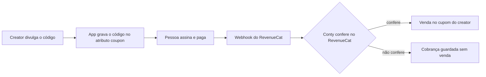

## O que você ganha

- **Assinatura do app vira venda do creator.** Cada compra e cada renovação paga no App Store ou no Google Play, com o código de um creator, vira venda do cupom dele, com comissão.
- **Conferência antes de contar.** A Conty busca cada cobrança no RevenueCat com a sua chave antes de registrar a venda. Evento de sandbox nunca vira venda.
- **Reembolso tratado.** O reembolso cancela a venda, e a comissão sai ou é estornada pelas [regras do cupom](/api/referencia/cupons#pagamento-da-comissão).



## Antes de começar

- **Conector liberado.** A Conty libera para a sua marca os conectores, os cupons e o RevenueCat. Se ele não aparece em **Plugins → Conectores**, fale com o seu contato na Conty.
- **Permissão na Conty.** O seu cargo precisa da permissão **Gerenciar integrações**.
- **App no RevenueCat.** O app já usa o SDK do RevenueCat para vender a assinatura.
- **Acordo com cupom por creator.** No passo financeiro do acordo, ligue **Cupom de desconto** e **Pagar comissão sobre vendas**, com a taxa e a verba de comissão. Cada creator aprovado ganha um cupom próprio, e o código desse cupom é o que o app grava na compra.
- **Quantas cobranças comissionam.** No mesmo passo, o campo **Cobranças de assinatura que comissionam** diz quantas cobranças de cada assinante viram venda. Vazio comissiona todas. Ver [Comissão](#comissão).

## Conectar

<Steps>
  <Step title="Crie a chave secreta no RevenueCat">
    No RevenueCat, abra o projeto do app e vá em **Project settings → API keys**. Crie uma **chave secreta da API v2** (**+ New secret API key**, versão **V2**) com estas permissões, e só elas:

    - **Project configuration**: **Read only**.
    - **Customer information**: **Read only** em **Customers**, **Subscriptions** e **Purchases**.

    Copie a chave. Ela começa com `sk_`. A chave pública do app (`appl_…`, `goog_…`) e as chaves secretas da API v1 não servem.
  </Step>
  <Step title="Copie o ID do projeto">
    Ele começa com `proj` e aparece no endereço do painel do RevenueCat, logo depois de `/projects/`: em `https://app.revenuecat.com/projects/proj1a2b3c4d/overview`, o ID é `proj1a2b3c4d`.
  </Step>
  <Step title="Conecte na Conty">
    Abra **Plugins → Conectores → RevenueCat** e clique em **Conectar**. Na janela **Conectar com RevenueCat**, cole a chave em **Secret key (sk_…)** e o ID em **ID do projeto**, e clique em **Conectar**.

    A Conty testa a chave e o projeto no RevenueCat antes de salvar. Se falta algo, a janela diz o quê (veja [Erros comuns](#erros-comuns)).
  </Step>
  <Step title="Copie a URL do webhook e o Authorization">
    A janela **RevenueCat conectado** mostra a **URL do webhook** e o **Authorization**. Copie os dois agora: eles não aparecem de novo. Depois clique em **Concluir**.
  </Step>
  <Step title="Cadastre o webhook no RevenueCat">
    No RevenueCat, abra **Integrations → Webhooks**, crie um webhook e preencha:

    - **Webhook URL**: a URL do webhook que a Conty mostrou. Ela termina em `/webhooks/subscriptions/revenuecat/{tenant}/{id da conexão}`.
    - **Authorization header value**: o Authorization que a Conty mostrou, exatamente como veio, sem `Bearer` na frente.
    - **Environment**: produção e sandbox. O sandbox serve para testar e nunca vira venda.

    Salve. A Conty compara o header `Authorization` de cada evento com o da conexão. Se não bate, o webhook responde `401` e nada é gravado.
  </Step>
</Steps>

<Warning>
  Perdeu o Authorization? Desconecte o RevenueCat na Conty e conecte de novo. A nova conexão gera **outra URL e outro Authorization**: atualize o webhook no RevenueCat, senão os eventos param de chegar.
</Warning>

## Gravar o código do creator no app

O app grava o código no atributo `coupon` do assinante, com o SDK do RevenueCat que ele já usa. A Conty não tem SDK próprio para isso: é uma linha, chamada **antes** de iniciar a compra.

<CodeGroup>
```tsx React Native
import Purchases from "react-native-purchases";

await Purchases.setAttributes({ coupon: code });
// depois: Purchases.purchasePackage(pkg)
```

```swift Swift
import RevenueCat

Purchases.shared.attribution.setAttributes(["coupon": code])
// depois: Purchases.shared.purchase(package: pkg)
```

```kotlin Kotlin
import com.revenuecat.purchases.Purchases

Purchases.sharedInstance.setAttributes(mapOf("coupon" to code))
// depois: Purchases.sharedInstance.purchaseWith(...)
```

```dart Flutter
import 'package:purchases_flutter/purchases_flutter.dart';

await Purchases.setAttributes({'coupon': code});
// depois: Purchases.purchasePackage(pkg)
```
</CodeGroup>

O RevenueCat manda os atributos do assinante em cada evento do webhook. A Conty lê `subscriber_attributes.coupon.value` e procura um cupom ativo da sua marca com esse código. A comparação ignora maiúsculas e espaços nas pontas: `ana10` acha o cupom `ANA10`. Apps que já gravam o atributo antigo `conty_coupon` continuam funcionando; quando os dois existem, vale o `coupon`.

<Note>
  Grave o código antes da compra. A primeira cobrança é avaliada com os atributos que o assinante tinha quando o RevenueCat mandou o evento. Se o código só aparece depois, a primeira cobrança fica sem dono e só as próximas contam.
</Note>

### De onde vem o código

A loja de apps não repassa o código para o app, então o app precisa pegar o código da pessoa:

- **Campo "Tem um cupom?" no paywall.** O jeito mais simples, e funciona em qualquer plataforma. O creator divulga o código, a pessoa digita.
- **Deep link.** Se a pessoa já tem o app e abre um link seu com o código (por exemplo `seuapp://assinar?cupom=ANA10`), o app lê o parâmetro e grava.

Parâmetros do link da loja (App Store ou Google Play) não chegam ao app depois da instalação. Quem instala pelo link do creator abre o app sem o código, e a venda só tem dono se o código for informado no app.

<Accordion title="Opção avançada no Android: Install Referrer">
  O Google Play repassa o parâmetro `referrer` do link da loja para o app, pela [Play Install Referrer API](https://developer.android.com/google/play/installreferrer). Se o link do creator for `https://play.google.com/store/apps/details?id=com.suamarca.app&referrer=coupon%3DANA10`, o app lê o referrer na primeira abertura e chama o `setAttributes` com o código. Isso é código do seu app, fora da Conty. No iOS não existe nada equivalente.
</Accordion>

## Conferir que funcionou

**Sandbox nunca vira venda, por desenho.** Evento com `environment` diferente de `PRODUCTION` fica sem venda. Use o sandbox para conferir a ligação, não para ver venda.

1. **Teste o webhook.** No RevenueCat, use **Send test event**. Resposta `200` quer dizer que a URL e o Authorization estão certos. O evento de teste não é cobrança e não muda nada na Conty.
2. **Faça uma compra de sandbox** com o código gravado. Na página do conector, **Última cobrança** passa a mostrar a hora do evento. Isso confirma que a cobrança chegou e foi lida.
3. **Primeira venda de verdade.** A primeira compra em produção com o código de um creator aparece como venda no cupom dele, nos resultados do acordo e em [`GET /coupons/{id}/sales`](/api/guias/registrar-vendas#consultar-as-vendas), com `external_id` `sub:revenuecat:{transaction_id}`.

O webhook da Conty responde:

| Status | Corpo | Quando |
|---|---|---|
| `200` | `{ "ok": true }` | Evento recebido, virando venda ou não |
| `401` | `{ "error": "Invalid token" }` | O `Authorization` não bate com a conexão |
| `404` | `{ "error": "Not found" }` | Conexão não existe ou foi desconectada |
| `503` | `{ "error": "Retry later" }` | O RevenueCat não respondeu na conferência. Ele reenvia o evento |

## Como a Conty decide se vira venda

Toda cobrança paga que chega é guardada. Ela vira venda do cupom só se passar por todas as conferências, nesta ordem:

| Situação | Status da cobrança | Vira venda? |
|---|---|---|
| Evento de sandbox (fora de `PRODUCTION`) | `unverified` | Não |
| Moeda diferente de BRL | `unsupported_currency` | Não |
| Valor líquido zero (teste grátis) | `zero_amount` | Não |
| Não confirmada no RevenueCat | `unverified` | Não |
| Código vazio, desconhecido ou de cupom cancelado | `unattributed` | Não |
| Além do limite de cobranças da política | `over_policy` | Não |
| Passou em tudo | `paid` | Sim |
| Reembolso | `refunded` | Cancela a venda |

**Confirmada no RevenueCat** quer dizer que a Conty chamou `GET https://api.revenuecat.com/v2/projects/{project_id}/customers/{app_user_id}/subscriptions` e `/purchases` com a sua chave. A transação do evento precisa estar lá, em produção (não sandbox nem Test Store) e sem reembolso.

Os eventos que contam são `INITIAL_PURCHASE`, `RENEWAL` e `NON_RENEWING_PURCHASE` pagos, e `CANCELLATION` com `cancel_reason` `CUSTOMER_SUPPORT`, que é como o RevenueCat avisa reembolso. Compra e renovação com valor zero nem chegam a ser guardadas. Os outros eventos são ignorados, e o mesmo evento repetido não duplica a venda.

## Comissão

A venda de assinatura é uma venda de cupom como as outras: a comissão é reservada na verba do acordo e paga ao creator 7 dias depois da venda.

**Valor da venda é o líquido**, o que a marca recebe: `price_in_purchased_currency × takehome_percentage`, em centavos. Uma compra de R$ 19,90 com `takehome_percentage` `0.85` vira venda de `1692` centavos. Se o evento não traz o `takehome_percentage`, a Conty usa `0.7`.

**Cobranças de assinatura que comissionam.** O campo no passo financeiro do acordo define quantas cobranças pagas de cada assinante viram venda:

- **Vazio:** todas as cobranças, enquanto a pessoa continuar assinando.
- **1:** só a primeira.
- **N:** até a N-ésima. A partir da N+1, a cobrança fica `over_policy`, sem venda.

A contagem é por assinante (o `app_user_id`) dentro do acordo. Cobrança reembolsada continua contando: com a política 1, se a primeira cobrança foi reembolsada, a segunda não comissiona.

## Erros comuns

<AccordionGroup>
  <Accordion title="A chave não tem todas as permissões. Falta marcar: …">
    A chave não tem uma das permissões do passo 1. Edite a chave no RevenueCat, marque o que o aviso lista e conecte de novo.
  </Accordion>
  <Accordion title="Essa chave é da API v1. Crie uma chave secreta v2.">
    Você colou uma chave secreta antiga, da v1. Crie uma chave da **v2** em **Project settings → API keys**.
  </Accordion>
  <Accordion title="A chave não pertence ao projeto informado no RevenueCat.">
    A chave é de outro projeto. Confira o `proj…` no endereço do painel, com o projeto da chave aberto.
  </Accordion>
  <Accordion title="A chave informada foi recusada pelo provedor.">
    A chave está errada, foi apagada ou não começa com `sk_`. Copie de novo, sem espaços.
  </Accordion>
  <Accordion title="Webhook responde 401">
    O **Authorization header value** no RevenueCat está diferente do que a Conty mostrou. Se perdeu o valor, desconecte, conecte de novo e atualize o webhook com a URL e o Authorization novos.
  </Accordion>
  <Accordion title="A cobrança chegou, mas não virou venda">
    Veja a tabela [Como a Conty decide se vira venda](#como-a-conty-decide-se-vira-venda). O caso mais comum é o app não ter gravado o `coupon` antes da compra: a cobrança fica `unattributed`, sem dono e sem comissão.
  </Accordion>
  <Accordion title="E o Android?">
    Funciona igual: a compra no Google Play chega pelo mesmo webhook, com os mesmos atributos. O código vem do campo no paywall ou do deep link. O Android tem a opção a mais do Install Referrer.
  </Accordion>
  <Accordion title="Preciso de um produto separado na loja para quem vem de creator?">
    Não. O mesmo produto e a mesma oferta servem. O que liga a compra ao creator é o código gravado no `coupon`.
  </Accordion>
</AccordionGroup>

O que o conector coleta está na [referência do conector RevenueCat](/api/referencia/conectores/revenuecat).
