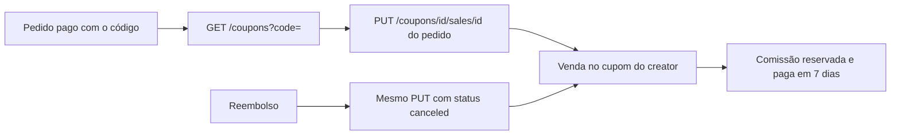

Use este guia quando a venda acontece num checkout próprio, no Stripe ou numa plataforma sem conector. O seu sistema avisa a Conty a cada venda feita com o cupom de um creator, e a Conty calcula a comissão.

<Note>
  Loja na Shopify ou na Nuvemshop, assinatura no RevenueCat ou cobrança no Asaas? [Use o conector](/api/guias): ele registra as vendas sozinho e você não precisa deste guia.
</Note>

## Antes de começar

- **Chave de API e cupons liberados.** Veja [Primeiros passos](/api/guias/primeiros-passos).
- **O creator tem um cupom.** A venda é registrada no cupom. Você cria o cupom pela API quando o creator é aprovado, como mostra [Cupom por creator](/api/guias/cupom-por-creator), ou a Conty cria pelo acordo com cupom por creator.
- **O seu checkout guarda o código.** No pedido, guarde o código do cupom que a pessoa usou. É ele que liga a venda ao creator.

## Como funciona



<Steps>
  <Step title="Ache o id do cupom pelo código">
    A rota de venda pede o `id` do cupom. Se você guardou o id quando criou o cupom, pule este passo. Se só tem o código que a pessoa digitou, busque:

    <CodeGroup>
    ```bash curl
    curl "https://api.appconty.com/public/v1/coupons?code=ANA10&status=active" \
      -H "Authorization: Bearer $CONTY_API_KEY"
    ```

    ```javascript Node.js
    async function couponIdByCode(code) {
      const url = new URL("https://api.appconty.com/public/v1/coupons");
      url.searchParams.set("code", code.trim().toUpperCase());
      url.searchParams.set("status", "active");
      const response = await fetch(url, {
        headers: { Authorization: `Bearer ${process.env.CONTY_API_KEY}` },
      });
      const body = await response.json();
      if (!response.ok) throw new Error(`${body.error.code}: ${body.error.message}`);
      return body.data[0]?.id ?? null; // null: código que não é de creator
    }
    ```
    </CodeGroup>

    O código não repete entre os cupons ativos da marca, então a lista traz no máximo um. Lista vazia quer dizer que o código não é de nenhum creator: não registre a venda.
  </Step>

  <Step title="Registre a venda">
    Chame `PUT /coupons/{id}/sales/{external_id}`. O `external_id` é o id do pedido no seu sistema, com até 200 caracteres.

    | Campo | O que mandar |
    |---|---|
    | `amount_cents` | Valor pago pelo cliente nos produtos, em centavos, já com o desconto do cupom, sem frete e sem impostos destacados. A comissão é calculada sobre ele. |
    | `status` | `confirmed` para venda paga. `canceled` para estorno. |
    | `occurred_at` | Quando a venda aconteceu, em ISO 8601. Não a hora do envio. |

    <CodeGroup>
    ```bash curl
    curl -X PUT https://api.appconty.com/public/v1/coupons/4f2c7a1e-9b3d-4c8a-a1f0-6d2e8b7c5a10/sales/pedido-10293 \
      -H "Authorization: Bearer $CONTY_API_KEY" \
      -H "Content-Type: application/json" \
      -d '{ "amount_cents": 15000, "status": "confirmed", "occurred_at": "2026-10-21T14:30:00Z" }'
    ```

    ```javascript Node.js
    async function syncSale(couponId, order) {
      const url = `https://api.appconty.com/public/v1/coupons/${couponId}/sales/${encodeURIComponent(order.id)}`;
      const response = await fetch(url, {
        method: "PUT",
        headers: {
          Authorization: `Bearer ${process.env.CONTY_API_KEY}`,
          "Content-Type": "application/json",
        },
        body: JSON.stringify({
          amount_cents: order.productsTotalCents,
          status: order.refunded ? "canceled" : "confirmed",
          occurred_at: order.paidAt,
        }),
      });
      const body = await response.json();
      if (!response.ok) throw new Error(`${body.error.code}: ${body.error.message}`);
      return body; // 201 criou, 200 atualizou
    }
    ```
    </CodeGroup>

    Responde `201` quando a venda é nova e `200` quando ela já existia e foi atualizada:

    ```json 201
    {
      "id": "8a1d3c5e-7f20-4b6a-9c8d-1e2f3a4b5c6d",
      "external_id": "pedido-10293",
      "amount_cents": 15000,
      "status": "confirmed",
      "creator": { "id": "9d3f1b7c-5e2a-4c8d-a6b1-2f3e4d5c6b7a", "name": "Fulana Souza", "handle": "@fulana" },
      "mission_id": "2b9e4d7a-1c3f-4e5a-8b6d-9f0a1c2e3d4b",
      "commission_rate_bps": 2500,
      "commission_cents": 3750,
      "commission_status": "reserved",
      "commission_due_on": "2026-10-28",
      "commission_paid_at": null,
      "commission_reversed_at": null,
      "occurred_at": "2026-10-21T14:30:00.000Z",
      "created_at": "2026-10-21T14:30:02.000Z",
      "updated_at": "2026-10-21T14:30:02.000Z"
    }
    ```
  </Step>

  <Step title="Mande o estorno quando houver">
    Reembolso, cancelamento ou chargeback é o mesmo `PUT`, com o mesmo `external_id` e `"status": "canceled"`:

    ```bash
    curl -X PUT https://api.appconty.com/public/v1/coupons/4f2c7a1e-9b3d-4c8a-a1f0-6d2e8b7c5a10/sales/pedido-10293 \
      -H "Authorization: Bearer $CONTY_API_KEY" \
      -H "Content-Type: application/json" \
      -d '{ "amount_cents": 15000, "status": "canceled", "occurred_at": "2026-10-21T14:30:00Z" }'
    ```

    A venda sai dos totais do cupom. A comissão sai da verba ou é estornada do creator, conforme o dia em que o estorno chega. Veja [Reembolso](/api/guias/cupom-por-creator#reembolso).
  </Step>
</Steps>

## Repetir é seguro

A venda é identificada pelo par cupom + `external_id`. Chamar de novo com o mesmo `external_id` atualiza a venda em vez de criar outra. Por isso:

- **Pode reenviar à vontade.** Se o seu webhook de pagamento chega duas vezes, ou se você reprocessa um lote, a venda conta uma vez só.
- **Use um id estável.** O id do pedido, não um UUID gerado a cada chamada. Um id novo é uma venda nova.
- **Mudou o valor?** Mande o `PUT` de novo com o novo `amount_cents`. A `commission_cents` é recalculada com a taxa gravada na venda.

O que **não muda** depois de criada a venda, mesmo que você mande outro valor:

- `occurred_at`, a data da venda;
- `commission_rate_bps`, a taxa do acordo naquele momento;
- `creator` e `mission_id`, o dono do cupom naquele momento. Se o cupom trocar de dono depois, a venda continua com quem era o dono.

## Consultar as vendas

`GET /coupons/{id}/sales` lista as vendas do cupom, da mais nova para a mais antiga, com paginação por cursor (`limit` até 100). Os conectores gravam aqui também, com `external_id` `shopify:…`, `nuvemshop:…`, `sub:revenuecat:…` ou `sub:asaas:…`.

<CodeGroup>
```bash curl
curl "https://api.appconty.com/public/v1/coupons/4f2c7a1e-9b3d-4c8a-a1f0-6d2e8b7c5a10/sales?limit=100" \
  -H "Authorization: Bearer $CONTY_API_KEY"
```

```javascript Node.js
async function* allSales(couponId) {
  let cursor = null;
  do {
    const url = new URL(`https://api.appconty.com/public/v1/coupons/${couponId}/sales`);
    url.searchParams.set("limit", "100");
    if (cursor) url.searchParams.set("cursor", cursor);
    const response = await fetch(url, {
      headers: { Authorization: `Bearer ${process.env.CONTY_API_KEY}` },
    });
    const body = await response.json();
    if (!response.ok) throw new Error(`${body.error.code}: ${body.error.message}`);
    yield* body.data;
    cursor = body.has_more ? body.next_cursor : null;
  } while (cursor);
}
```
</CodeGroup>

Para os totais do cupom (vendas, receita e comissão reservada, paga e aguardando verba), use `GET /coupons/{id}`. O que cada `commission_status` quer dizer está em [Cupons](/api/referencia/cupons#pagamento-da-comissão).

## Regras que valem para toda venda

- **Data entre a criação do cupom e agora.** `occurred_at` antes de o cupom existir, ou no futuro, responde `422 sale_occurred_at_out_of_range`.
- **Venda depois do fim do acordo não tem comissão.** Ela é registrada com `commission_status` `after_campaign_end`.
- **Taxa `0` é só rastreio.** A venda conta, a comissão vem `0`.
- **Cupom cancelado aceita venda.** A venda pode ter acontecido antes do cancelamento.
- **Cupom disponível (sem creator) aceita venda,** que fica sem creator.

## Erros comuns

<AccordionGroup>
  <Accordion title="422 sale_occurred_at_out_of_range">
    A data da venda está antes da criação do cupom ou no futuro. Mande a data real do pagamento, em ISO 8601 com fuso (`2026-10-21T14:30:00Z` ou `2026-10-21T11:30:00-03:00`).
  </Accordion>
  <Accordion title="422 validation_failed">
    Falta um campo ou o valor está fora do formato. `amount_cents` é inteiro maior que zero, em centavos (`15000` é R$ 150,00). `status` é `confirmed` ou `canceled`. O campo errado vem em `error.details`.
  </Accordion>
  <Accordion title="404 not_found">
    O id do cupom não existe ou é de outra marca. Confira se usou o `id` do cupom (não o código) e a chave da marca certa.
  </Accordion>
  <Accordion title="403 coupons_disabled">
    Os cupons não estão liberados para a marca. Fale com o seu contato na Conty.
  </Accordion>
  <Accordion title="A venda aparece duplicada">
    O `external_id` mudou entre as chamadas. Use sempre o id do pedido, nunca um valor gerado na hora.
  </Accordion>
</AccordionGroup>
