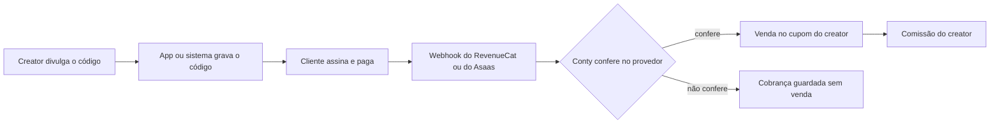

Cada creator do acordo tem um código, o mesmo do cupom dele. O seu app ou o seu sistema grava esse código na compra. O provedor de pagamento avisa a Conty por webhook, e a Conty confere a cobrança no provedor antes de contar.

**Quem indicou** (o código do creator) mais **quem pagou** (a cobrança conferida no provedor) é igual a **venda do cupom e comissão do creator**.



Use o **RevenueCat** para assinatura dentro do app (App Store e Google Play). Use o **Asaas** para assinatura e cobrança no site ou no seu sistema. Dá para ligar os dois na mesma marca.

## Antes de começar

- **Conectores liberados.** A Conty libera para a sua marca os conectores, os cupons e o conector que você vai usar (RevenueCat, Asaas ou os dois). Se ele não aparece em **Plugins → Conectores**, fale com o seu contato na Conty.
- **Permissão.** Para conectar, o seu cargo precisa da permissão **Gerenciar integrações**.
- **Acordo com cupom por creator.** No passo financeiro do acordo, ligue **Cupom de desconto** e **Pagar comissão sobre vendas**, com a taxa e a verba de comissão. Cada creator aprovado ganha um cupom próprio, e o código desse cupom é o que o app ou o sistema grava na compra. Ver [Cupom por creator](/api/guias/cupom-por-creator).
- **Política de cobranças.** No mesmo passo, o campo **Cobranças de assinatura que comissionam** diz quantas cobranças de cada assinante viram venda. Vazio comissiona todas. Ver [Comissão](#comissão).

## Passo a passo

<Steps>
  <Step title="Conecte o RevenueCat">
    1. No RevenueCat, abra o projeto do app e vá em **Project settings → API keys**. Crie uma **chave secreta da API v2** (**+ New secret API key**, versão **V2**) com estas permissões, e só elas:
       - **Project configuration**: **Read only**.
       - **Customer information**: **Read only** em **Customers**, **Subscriptions** e **Purchases**.

       Copie a chave. A chave pública do app (`appl_…`, `goog_…`) e as chaves secretas da API v1 não servem.
    2. Copie o **ID do projeto**. Ele começa com `proj` e aparece no endereço do painel do RevenueCat, logo depois de `/projects/`: em `https://app.revenuecat.com/projects/proj1a2b3c4d/overview`, o ID é `proj1a2b3c4d`.
    3. Na Conty, abra **Plugins → Conectores**, escolha **RevenueCat** e clique em **Conectar**. Cole a chave secreta e o ID do projeto e confirme. A Conty testa os dois no RevenueCat antes de salvar. Se algo falta, o painel diz o quê:
       - **"Falta marcar: …"**: a chave não tem uma das permissões acima. Edite a chave no RevenueCat, marque o que o aviso lista e tente de novo.
       - **Chave da API v1**: você colou uma chave secreta antiga, da v1. Crie uma chave da **v2**.
       - **ID do projeto não bate com a chave**: a chave é de outro projeto. Confira o `proj…` no endereço do painel, com o projeto da chave aberto.
    4. A Conty mostra a **URL do webhook** e o **Authorization**. Copie os dois agora: eles aparecem uma vez só.
    5. No RevenueCat, abra **Integrations → Webhooks**, crie um webhook e preencha:
       - **Webhook URL**: a URL do webhook que a Conty mostrou. Ela termina em `/webhooks/subscriptions/revenuecat/{tenant}/{id da conexão}`.
       - **Authorization header value**: o Authorization que a Conty mostrou, exatamente como veio, sem `Bearer` na frente.
       - **Environment**: produção e sandbox. O sandbox serve para testar e nunca vira venda.
    6. Salve.

    A Conty compara o header `Authorization` de cada evento com o da conexão. Se não bate, o webhook responde `401` e nada é gravado.

    <Warning>
      Perdeu o Authorization? Conecte de novo. A nova conexão substitui a anterior e gera **outra URL e outro Authorization**. Atualize o webhook no RevenueCat, senão os eventos param de chegar.
    </Warning>
  </Step>

  <Step title="Grave o código do creator antes da compra">
    O app grava o código no atributo `coupon` do assinante, com o SDK do RevenueCat que ele já usa. A Conty não tem SDK próprio para isso: é uma linha do SDK do RevenueCat, chamada **antes** de iniciar a compra.

    <CodeGroup>
    ```tsx React Native
    import Purchases from "react-native-purchases";

    await Purchases.setAttributes({ coupon: code });
    // depois: Purchases.purchasePackage(pkg)
    ```

    ```swift Swift
    import RevenueCat

    Purchases.shared.attribution.setAttributes(["coupon": code])
    // depois: Purchases.shared.purchase(package: pkg)
    ```

    ```kotlin Kotlin
    import com.revenuecat.purchases.Purchases

    Purchases.sharedInstance.setAttributes(mapOf("coupon" to code))
    // depois: Purchases.sharedInstance.purchaseWith(...)
    ```

    ```dart Flutter
    import 'package:purchases_flutter/purchases_flutter.dart';

    await Purchases.setAttributes({'coupon': code});
    // depois: Purchases.purchasePackage(pkg)
    ```
    </CodeGroup>

    O RevenueCat manda os atributos do assinante em cada evento do webhook. A Conty lê `subscriber_attributes.coupon.value` e procura um cupom ativo da sua marca com esse código. A comparação ignora maiúsculas e espaços nas pontas: `ana10` acha o cupom `ANA10`. Apps que já gravam o atributo antigo `conty_coupon` continuam funcionando; quando os dois existem, vale o `coupon`.

    **De onde vem o código.** A loja de apps não repassa o código para o app, então o app precisa pegar o código da pessoa:

    - **Campo "Tem um cupom?" no paywall.** O jeito mais simples e o que funciona em qualquer plataforma. O creator divulga o código, a pessoa digita.
    - **Deep link.** Se a pessoa já tem o app e abre um link seu com o código (por exemplo `seuapp://assinar?cupom=ANA10`), o app lê o parâmetro e grava.

    **O limite.** Parâmetros do link da loja (App Store ou Google Play) não chegam ao app depois da instalação. Quem instala pelo link do creator abre o app sem o código, e a venda só tem dono se o código for informado no app.

    <Accordion title="Opção avançada no Android: Install Referrer">
      O Google Play repassa o parâmetro `referrer` do link da loja para o app, pela [Play Install Referrer API](https://developer.android.com/google/play/installreferrer). Se o link do creator for `https://play.google.com/store/apps/details?id=com.suamarca.app&referrer=coupon%3DANA10`, o app lê o referrer na primeira abertura e chama o `setAttributes` com o código. Isso é código do seu app, fora da Conty. No iOS não existe nada equivalente.
    </Accordion>

    <Note>
      Grave o código antes da compra. A primeira cobrança é avaliada com os atributos que o assinante tinha quando o RevenueCat mandou o evento. Se o código só aparece depois, a primeira cobrança fica sem dono e só as próximas contam.
    </Note>
  </Step>

  <Step title="Conecte o Asaas e grave o código no externalReference">
    1. No Asaas, copie a **chave de API** da conta. A de produção começa com `$aact_prod_`; a de sandbox, com `$aact_hmlg_`.
    2. Na Conty, abra **Plugins → Conectores**, escolha **Asaas**, cole a chave em **Chave de API** e confirme.
    3. Pronto: a Conty testa a chave e cadastra sozinha um webhook de cobranças na sua conta do Asaas, com o nome **Conty - vendas de assinatura**. Você não copia nada. Não apague esse webhook no Asaas; para parar, desconecte na Conty, que remove o webhook.

    O código do creator vai no campo `externalReference` da assinatura ou da cobrança que o seu sistema cria no Asaas. Exemplo de assinatura mensal com o cupom `ANA10`:

    ```bash
    curl -X POST https://api.asaas.com/v3/subscriptions \
      -H "access_token: $ASAAS_API_KEY" \
      -H "Content-Type: application/json" \
      -d '{
        "customer": "cus_000005219613",
        "billingType": "CREDIT_CARD",
        "value": 29.90,
        "nextDueDate": "2026-11-15",
        "cycle": "MONTHLY",
        "description": "Plano mensal",
        "externalReference": "ANA10"
      }'
    ```

    Cobrança avulsa é igual, em `POST /v3/payments`, com o código no `externalReference`.

    A Conty procura o código nesta ordem:

    1. o `externalReference` da cobrança;
    2. se ele está vazio, o `externalReference` da assinatura da cobrança.

    <Warning>
      Se o seu sistema já usa o `externalReference` da cobrança para outra coisa (o id do pedido, por exemplo), a Conty lê esse valor, não acha cupom e a cobrança fica sem dono. Nesse caso, deixe o `externalReference` da cobrança vazio e grave o código só na assinatura.
    </Warning>

    No seu site, o código vem do mesmo lugar que no app: um campo de cupom no checkout, ou um parâmetro do link do creator que o site guarda até a compra.
  </Step>

  <Step title="Teste">
    **Sandbox nunca vira venda, por desenho.** No RevenueCat, evento com `environment` diferente de `PRODUCTION` fica sem venda. No Asaas, a conexão com chave de sandbox (`$aact_hmlg_`) recebe os eventos, mas nenhuma cobrança é confirmada. Use o sandbox para conferir a ligação, não para ver venda.

    Para conferir:

    - **RevenueCat:** no webhook, use **Send test event**. Resposta `200` quer dizer que a URL e o Authorization estão certos; `401` quer dizer que o Authorization está errado; `404` quer dizer que a conexão foi refeita ou desconectada. O evento de teste não é cobrança e não muda nada na Conty.
    - **Compra de sandbox:** faça uma compra de teste no app com o código gravado, ou crie uma cobrança na conta de sandbox do Asaas e pague. Na página do conector na Conty, **Última cobrança** passa a mostrar a hora do evento. Isso confirma que a cobrança chegou e foi lida.
    - **Venda de verdade:** a primeira compra em produção com o código de um creator aparece como venda no cupom dele, nos resultados do acordo e em [`GET /coupons/{id}/sales`](/api/referencia/cupons), com `external_id` `sub:revenuecat:{transaction_id}` ou `sub:asaas:{id da cobrança}`.

    O webhook da Conty responde:

    | Status | Corpo | Quando |
    |---|---|---|
    | `200` | `{ "ok": true }` | Evento recebido, virando venda ou não |
    | `401` | `{ "error": "Invalid token" }` | `Authorization` (RevenueCat) ou `asaas-access-token` (Asaas) não bate com a conexão |
    | `404` | `{ "error": "Not found" }` | Conexão não existe ou não está ativa |
    | `503` | `{ "error": "Retry later" }` | O provedor não respondeu na conferência. O provedor reenvia o evento |
  </Step>
</Steps>

## Como a Conty decide se vira venda

Toda cobrança paga que chega é guardada. Ela vira venda do cupom só se passar por todas as conferências, nesta ordem:

| Situação | Status da cobrança | Vira venda? |
|---|---|---|
| Evento de sandbox (RevenueCat fora de `PRODUCTION`) | `unverified` | Não |
| Moeda diferente de BRL | `unsupported_currency` | Não |
| Valor líquido zero (teste grátis) | `zero_amount` | Não |
| Não confirmada no provedor | `unverified` | Não |
| Código vazio, desconhecido ou de cupom cancelado | `unattributed` | Não |
| Além do limite de cobranças da política | `over_policy` | Não |
| Passou em tudo | `paid` | Sim |
| Reembolso ou chargeback | `refunded` | Cancela a venda |

**Confirmada no provedor** quer dizer que a Conty buscou a cobrança com a sua chave antes de contar:

- **RevenueCat (API v2):** `GET https://api.revenuecat.com/v2/projects/{project_id}/customers/{app_user_id}/subscriptions` e `/purchases`. A transação do evento precisa estar lá, em produção (não sandbox nem Test Store) e sem reembolso.
- **Asaas:** `GET /v3/payments/{id}`, com status `RECEIVED`, `CONFIRMED` ou `RECEIVED_IN_CASH`.

No RevenueCat, compra e renovação com valor zero nem chegam a ser guardadas. Os eventos que contam são `INITIAL_PURCHASE`, `RENEWAL` e `NON_RENEWING_PURCHASE` pagos, e `CANCELLATION` com `cancel_reason` `CUSTOMER_SUPPORT`, que é como o RevenueCat avisa reembolso. No Asaas, contam `PAYMENT_RECEIVED` e `PAYMENT_CONFIRMED`, e o reembolso vem de `PAYMENT_REFUNDED`, `PAYMENT_CHARGEBACK_REQUESTED` e `PAYMENT_CHARGEBACK_DISPUTE`. Os outros eventos são ignorados.

O mesmo evento repetido não duplica a venda.

## Comissão

A venda de assinatura é uma venda de cupom como as outras. A comissão segue as [regras de pagamento do cupom](/api/referencia/cupons#pagamento-da-comissão): reservada na verba do acordo, paga ao creator 7 dias depois da venda.

**Cobranças de assinatura que comissionam.** O campo no passo financeiro do acordo define quantas cobranças pagas de cada assinante viram venda:

- **Vazio:** todas as cobranças, enquanto a pessoa continuar assinando.
- **1:** só a primeira.
- **N:** até a N-ésima. A partir da N+1, a cobrança fica `over_policy`, sem venda.

A contagem é por assinante (o `app_user_id` no RevenueCat, o `customer` no Asaas) dentro do acordo. Cobrança reembolsada continua contando: com a política 1, se a primeira cobrança foi reembolsada, a segunda não comissiona.

**Valor da venda é o líquido**, o que a marca recebe:

- **RevenueCat:** `price_in_purchased_currency × takehome_percentage`, em centavos. Uma compra de R$ 19,90 com `takehome_percentage` `0.85` vira venda de `1692` centavos. Se o evento não traz o `takehome_percentage`, a Conty usa `0.7`.
- **Asaas:** o `netValue` da cobrança, já sem a taxa do Asaas.

**Reembolso e chargeback** cancelam a venda, e a comissão sai ou é estornada pelas regras do cupom: antes do pagamento ao creator a comissão sai; depois, enquanto o creator ainda não pode sacar, ela é estornada.

## Perguntas frequentes

<AccordionGroup>
  <Accordion title="Preciso de um produto separado na loja para quem vem de creator?">
    Não. O mesmo produto e a mesma oferta servem. O que liga a compra ao creator é o código gravado no `coupon` (RevenueCat) ou no `externalReference` (Asaas).
  </Accordion>

  <Accordion title="E o Android?">
    Funciona igual pelo RevenueCat: a compra no Google Play chega pelo mesmo webhook, com os mesmos atributos. O código vem do campo no paywall ou do deep link, como no iOS. O Android tem a opção a mais do Install Referrer, descrita no passo 2.
  </Accordion>

  <Accordion title="E se o app não mandar o código?">
    A cobrança chega, fica guardada como `unattributed` e não vira venda. Ela não tem dono e não gera comissão para ninguém.
  </Accordion>

  <Accordion title="A venda em dólar conta?">
    Não. Só cobrança em BRL vira venda. Compra em outra moeda fica `unsupported_currency`.
  </Accordion>
</AccordionGroup>
