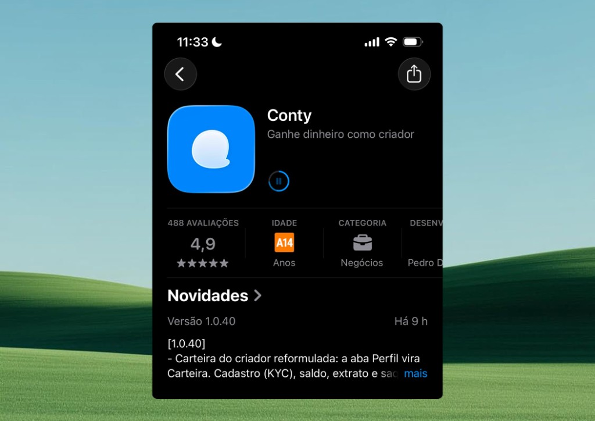

Para se candidatar, entregar conteúdo e receber, use o app da Conty no celular ou acesse pela web. A Conty é **gratuita para criadores**: não existe plano pago.

<Note>
  Para usar a Conty é preciso ter **18 anos ou mais**. O app só é liberado depois que a sua **carteira é aprovada pelo provedor de pagamentos**. Sem essa aprovação, não é possível usar a plataforma.
</Note>

  <CardGroup cols={3}>
    <Card title="iPhone" icon="apple" href="https://apps.apple.com/br/app/conty/id6744820060">
      App Store, iOS 16 ou superior.
    </Card>

    <Card title="Android" icon="android" href="https://play.google.com/store/apps/details?id=com.conty&hl=pt_BR">
      Play Store.
    </Card>

    <Card title="Web" icon="globe" href="https://www.appconty.com/pt/explore/creators-site">
      Acesse pelo navegador.
    </Card>
  </CardGroup>

<Frame caption="Tela de instalação do app">
  
</Frame>

## Instalar

<Tabs>
  <Tab title="iPhone">
    <Steps>
      <Step title="Abra a App Store">
        Procure por **Conty** ou use o link [apps.apple.com/br/app/conty/id6744820060](https://apps.apple.com/br/app/conty/id6744820060).
      </Step>
      <Step title="Toque em Obter">
        Aguarde a instalação terminar e abra o app.
      </Step>
    </Steps>
  </Tab>
  <Tab title="Android">
    <Steps>
      <Step title="Abra a Play Store">
        Procure por **Conty** ou use o link [play.google.com/store/apps/details?id=com.conty](https://play.google.com/store/apps/details?id=com.conty&hl=pt_BR).
      </Step>
      <Step title="Toque em Instalar">
        Aguarde a instalação terminar e abra o app.
      </Step>
    </Steps>
  </Tab>
  <Tab title="Web">
    <Steps>
      <Step title="Acesse a plataforma">
        Abra [appconty.com/pt/explore/creators-site](https://www.appconty.com/pt/explore/creators-site).
      </Step>
      <Step title="Entre na conta">
        Use o mesmo método de login do app (Google, e-mail ou Apple).
      </Step>
    </Steps>
  </Tab>
</Tabs>

## Primeiro acesso

<Steps>
  <Step title="Crie sua conta">
    A Conty recomenda se cadastrar com **e-mail** ou **Google**. O acesso por telefone não está mais disponível. Se já tiver conta, faça login sempre com o mesmo método que usou para criá-la.

    <Warning>
      Para não criar contas duplicadas, entre sempre com o mesmo método usado no cadastro (Google, e-mail ou Apple). Por exemplo: se o primeiro acesso foi pelo Google e depois você tentar entrar só com o e-mail, uma **nova conta** será criada.
    </Warning>

    <Frame caption="Entrar no app">
      <video autoPlay muted loop playsInline src="/images/criadores/videos/app-login-ficticio.mp4" />
    </Frame>
  </Step>
  <Step title="Cadastre e aprove sua carteira">
    Cadastre a sua carteira e aguarde a aprovação do provedor de pagamentos. O app só é liberado depois dessa aprovação. Veja o passo a passo em [Carteira](/criadores/carteira).

    <Frame caption="Cadastro da carteira no app">
      
    </Frame>
  </Step>
  <Step title="Ative as notificações">
    É por elas que você recebe **propostas** das marcas, campanhas novas, prazos e pagamentos. Sem notificação, você pode perder uma campanha. Se recusar sem querer, ative depois nas configurações do celular.
  </Step>
  <Step title="Faça o onboarding">
    Você mesmo descreve o seu trabalho: em quais **nichos** atua, quais **categorias** de conteúdo cria e quais **redes sociais** usa.
  </Step>
  <Step title="Conecte suas redes">
    Dá para conectar **Instagram**, **TikTok**, **YouTube** e **X**. As métricas são atualizadas **automaticamente**, sem precisar enviar nada manualmente.
  </Step>
  <Step title="Complete o perfil">
    Foto, nome, localização, dados demográficos e um resumo do que você cria. Quanto mais completo o perfil, mais fácil para as marcas encontrarem e selecionarem você para as campanhas certas.

    <Frame caption="Perfil do criador no app">
      <video autoPlay muted loop playsInline src="/images/criadores/videos/app-perfil-ficticio.mp4" />
    </Frame>

    <Frame caption="Ajustes da conta no app">
      <video autoPlay muted loop playsInline src="/images/criadores/videos/app-ajustes-ficticio.mp4" />
    </Frame>
  </Step>
</Steps>

<Tip>
  Quer um portfólio profissional e um link na bio? O [Conty.bio](https://conty.bio/) é a maneira oficial de criar portfólios na Conty: rápido, fácil, intuitivo e gratuito. Veja como em [Conty Bio](/criadores/conty-bio).
</Tip>

<Info>
  A análise da carteira pode levar **até 60 dias**, porque é feita pelo provedor de pagamentos e não depende da Conty. Assim que ela for aprovada, você recebe uma notificação no app e por e-mail.
</Info>

## Quanto custa

A Conty não cobra mensalidade dos criadores. Existe apenas uma **taxa de 5%** sobre o que você recebe, cobrada no **saque**. Até sacar, você vê o valor cheio que a marca pagou, e na hora do saque o app mostra a conta antes de você confirmar.

## Dúvidas comuns

<AccordionGroup>
  <Accordion title="Por que não consigo usar o app ainda?">
    O app só é liberado depois que a sua carteira é aprovada pelo provedor de pagamentos. É preciso ter 18 anos ou mais.
  </Accordion>

  <Accordion title="Posso criar conta com telefone?">
    Não. Hoje o cadastro e o login são feitos com e-mail, Google ou Apple. A Conty recomenda e-mail ou Google.
  </Accordion>

  <Accordion title="Preciso pagar para usar a Conty?">
    Não. Não existe plano pago para criadores. A Conty só cobra 5% do valor quando você saca.
  </Accordion>

  <Accordion title="Preciso atualizar minhas métricas?">
    Não. Com as redes conectadas, as métricas são atualizadas automaticamente.
  </Accordion>

  <Accordion title="Quais redes posso conectar?">
    Instagram, TikTok, YouTube e X.
  </Accordion>

  <Accordion title="Posso usar a Conty pelo computador?">
    Sim, pela versão web, entrando com o mesmo método de login do app (Google, e-mail ou Apple). O saque é feito só pelo app.
  </Accordion>

  <Accordion title="Como excluo a minha conta?">
    Você mesmo exclui pelo app: **Perfil** > **Configurações** > **Excluir conta**. A exclusão fica bloqueada enquanto houver saldo disponível na carteira, missão em andamento ou candidatura aguardando resposta. Antes, saque o saldo, conclua ou cancele a missão e cancele a candidatura. Se aparecer algum erro, fale com o suporte pelo **chat do app** e mande um print da tela.
  </Accordion>
</AccordionGroup>

## Próximo passo

  <CardGroup cols={2}>
    <Card title="Candidatar-se" icon="/icons/megaphone01.svg" href="/criadores/candidaturas">
      Como se inscrever em campanhas abertas.
    </Card>

    <Card title="Carteira" icon="/icons/wallet01.svg" href="/criadores/carteira">
      Cadastro facial e chave Pix para receber.
    </Card>
  </CardGroup>

