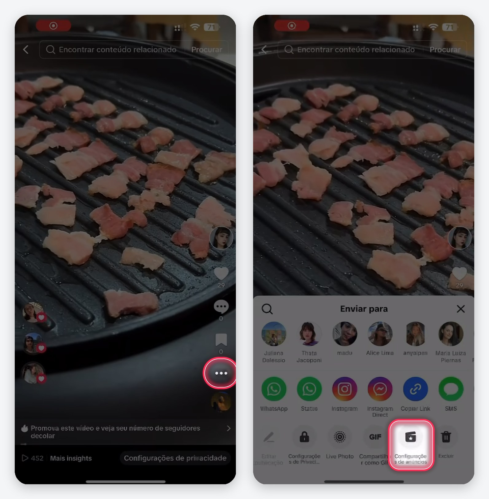
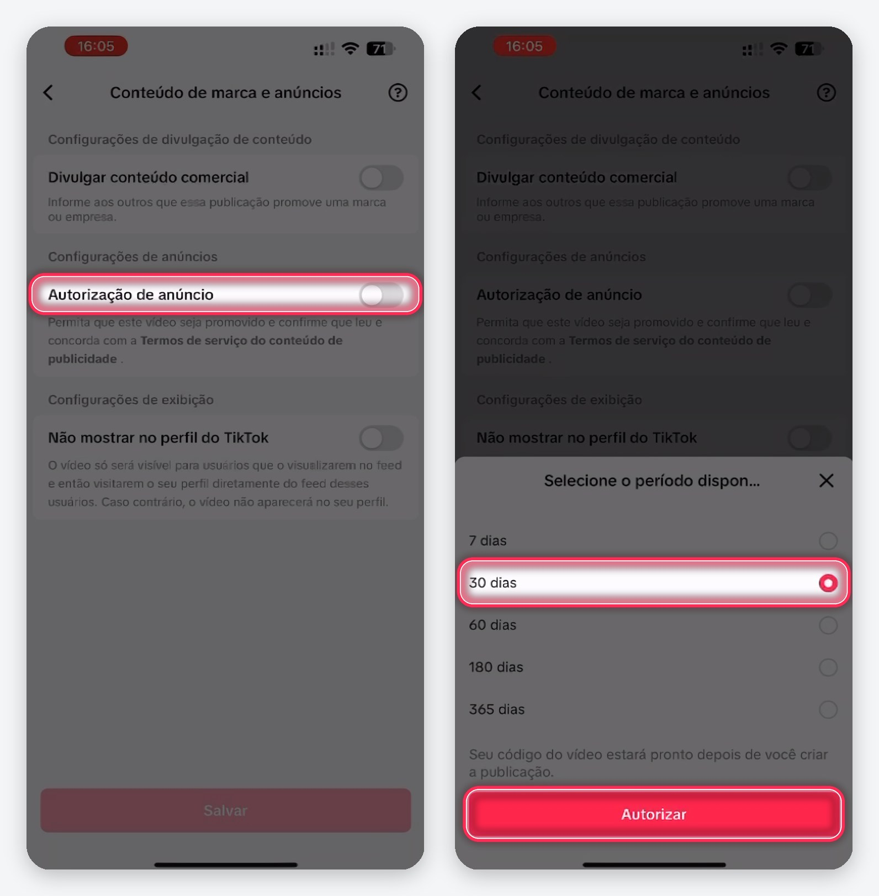
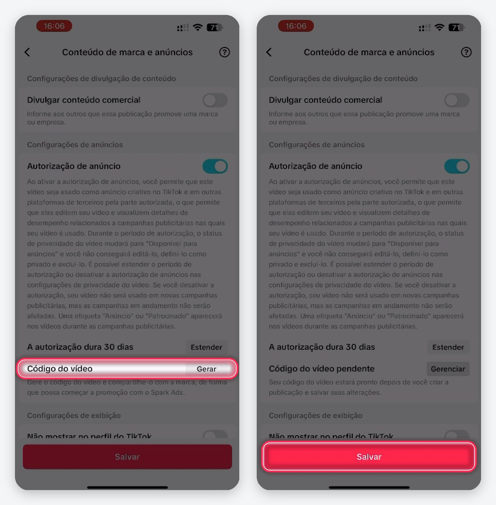
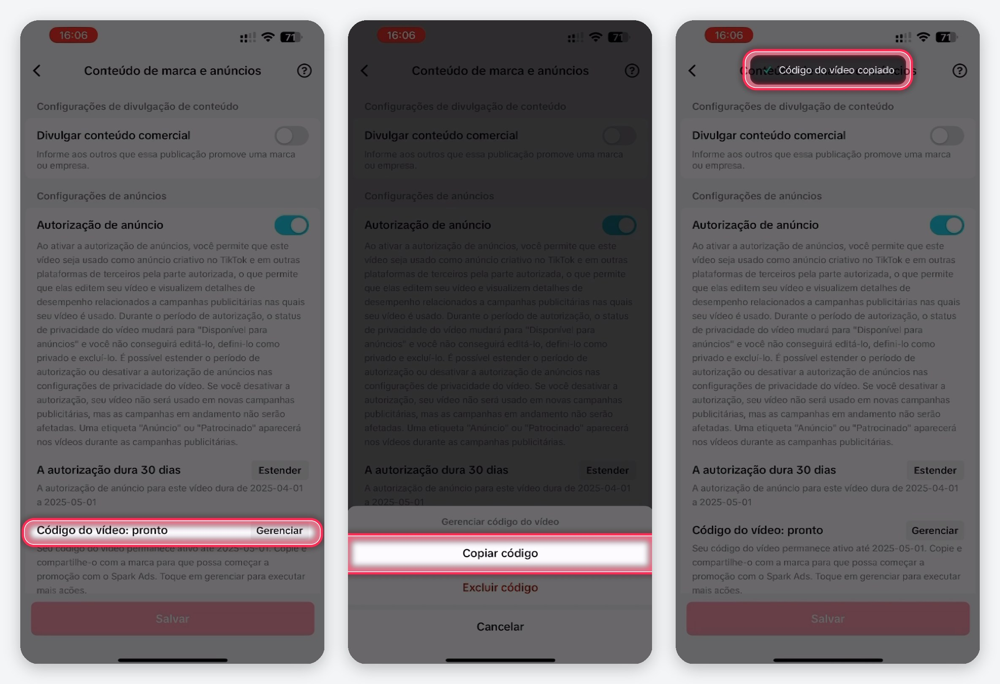

# Ad Code: como gerar o código de anúncio

Algumas campanhas pedem o **Ad Code**, o código de anúncio do seu post. Com ele, a marca impulsiona o vídeo que você publicou como anúncio, sem precisar da sua senha e sem tirar o post do seu perfil.

Você informa o código na própria entrega, depois que ela é aprovada: abra a campanha, toque em **Ad Code**, cole o código e salve.

<Note>
  O código só existe depois que o vídeo está publicado. Gere o código no post que você enviou na entrega.
</Note>

---

## TikTok

No TikTok, o Ad Code se chama **Código do vídeo**. Ele é gerado nas configurações de anúncio do próprio vídeo.

<Steps>
  <Step title="Abra as configurações de anúncio do vídeo">
    No vídeo publicado, toque nos três pontos (**…**). No menu que abre, deslize a última linha e toque em **Configurações de anúncios**.

    <Frame>
      
    </Frame>
  </Step>
  <Step title="Ative a autorização de anúncio">
    Ative **Autorização de anúncio**. Escolha o período que a marca pediu (se ela não pediu, use **30 dias**) e toque em **Autorizar**.

    <Frame>
      
    </Frame>
  </Step>
  <Step title="Gere o código do vídeo">
    Em **Código do vídeo**, toque em **Gerar** e depois em **Salvar**.

    <Frame>
      
    </Frame>
  </Step>
  <Step title="Copie o código">
    Quando aparecer **Código do vídeo: pronto**, toque em **Gerenciar** e em **Copiar código**. O TikTok confirma com a mensagem **Código do vídeo copiado**.

    <Frame>
      
    </Frame>
  </Step>
  <Step title="Cole o código na entrega">
    Volte para a campanha, toque em **Ad Code**, cole o código e salve.
  </Step>
</Steps>

<Warning>
  Não desative a autorização de anúncio nem exclua o código antes do fim do período combinado. Sem ele, a marca não consegue impulsionar o vídeo.
</Warning>

---

## Instagram

No Instagram, o Ad Code se chama **código do anúncio de parceria** e vale para Reels.

<Steps>
  <Step title="Abra o Reels publicado">
    Toque nos três pontos (**…**) do Reels e depois em **Rótulo e anúncios de parceria**.
  </Step>
  <Step title="Ative o código">
    Ative **Código do anúncio de parceria**.
  </Step>
  <Step title="Copie e cole na entrega">
    Toque em **Copiar**, volte para a campanha, toque em **Ad Code**, cole o código e salve.
  </Step>
</Steps>

---

## Dúvidas comuns

<AccordionGroup>
  <Accordion title="A opção de anúncio não aparece no meu vídeo">
    Confira se o vídeo está **público** e se a sua conta não é privada. No TikTok, contas comerciais e pessoais podem gerar o código. Se ainda assim não aparecer, atualize o app da rede social.
  </Accordion>
  <Accordion title="Gerei o código errado ou ele expirou">
    Gere um código novo no mesmo vídeo e substitua na entrega. Enquanto a entrega estiver aprovada, você pode trocar o código.
  </Accordion>
</AccordionGroup>
